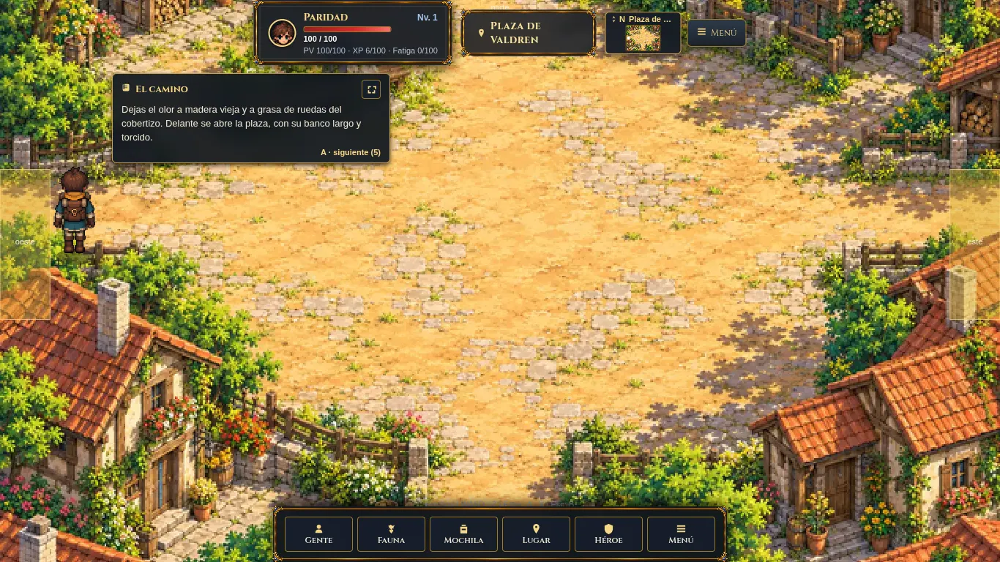
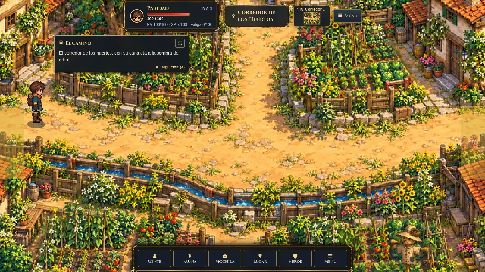
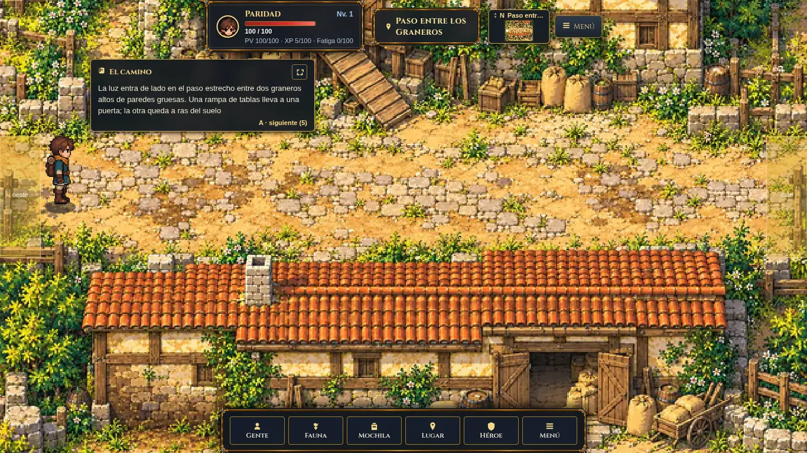
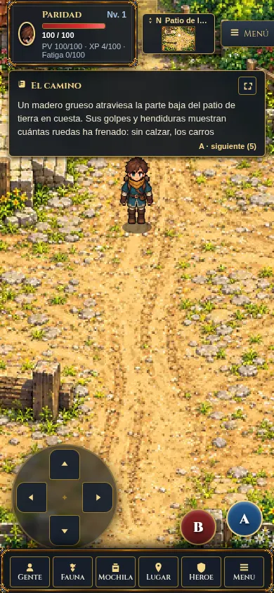
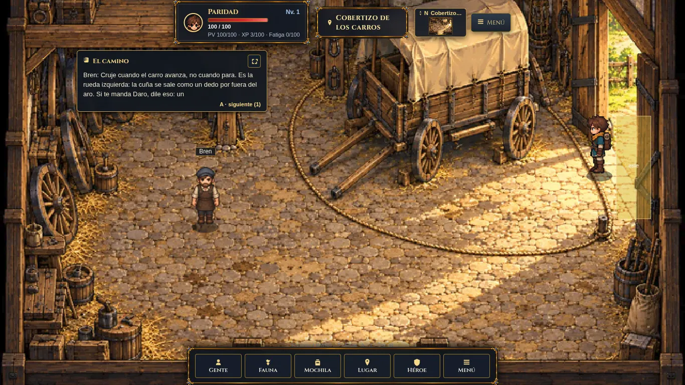
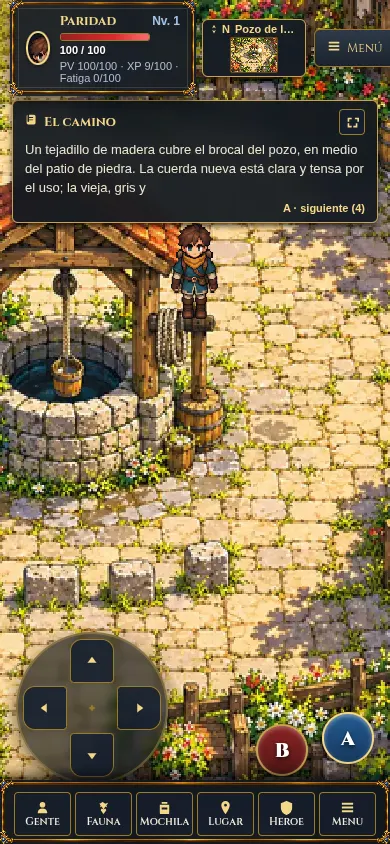
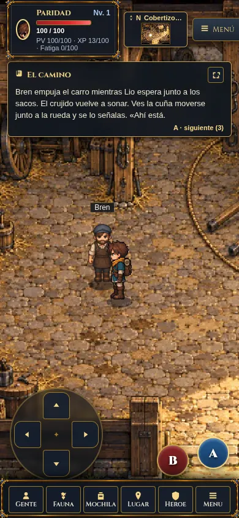

# Vaisgard RPG: Lote Valdren 01 (Fase 2) — Documento Técnico

**Fecha:** 2026-10-18
**Base:** `origin/main` (`8b62492486299eeadf159aa1b8acc609048528a5`)
**Rama:** `codex/rpg-valdren-01` (apilada sobre PR742)
**Worktree:** `/home/jdiaz/proyectos/wt-codex-rpg-valdren-01`
**Estado:** Candidato local validado; pendiente publicación y aprobación de integración/despliegue.

---

## 1. Inventario de Activos de Arte

AGY integró los fondos y sprites como copias exactas desde `wt-codex-rpg-valdren-01` respetando íntegramente los hashes SHA-256 y pesos de `manifest-arte.json`:

| Archivo en `client-rpg/` | Dimensiones | Bytes | SHA-256 |
|---|---|---:|---|
| `backgrounds/valdren_plaza.webp` | 1280×960 | 245 244 | `4e517625472c38c805abe530cf334c9447c19c37eaefcacde5dd2c878a4e5383` |
| `backgrounds/valdren_huertos.webp` | 1280×960 | 248 088 | `1a1b3588626642063839fec54b3e23b3045e368e88ca010f297a226ae6b3675b` |
| `backgrounds/valdren_graneros.webp` | 1280×960 | 246 836 | `a7878c6f789323c645fd6a4c3a7da39e00c4fa2ac77c1452b8e400ee79b8daf6` |
| `backgrounds/valdren_patio_carros.webp` | 1280×960 | 248 810 | `1359a02c900551eeab26b4bf65f44470cde62e4c07cc7de9c23616d0ff1e39f5` |
| `backgrounds/valdren_cobertizo.webp` | 1280×960 | 244 236 | `41109ff68e3d332a3877e76d43161509aa58f523de0382e23b5a4ebf053145d7` |
| `backgrounds/valdren_pozo.webp` | 1280×960 | 249 678 | `308436c79acb9ab16efa6f0c46ad513d76f35202d2b542c8e1dc52b057acca7c` |
| `sprites/bren.png` | 192×384 | 104 930 | `e967ece87957b794e5f2fa6b818a9f175c3264943d74498104185ac1311f075b` |

Se incorporaron además los 6 archivos sidecar `backgrounds/valdren_*.webp.json` con los metadatos y prompts de generación originales. El arquitecto sustituyó Huertos por la edición v2 con espantapájaros; la tabla recoge el hash final.

---

## 2. Geometría de Escenas y Mapeo de Colisiones

Cada sala se configuró en resolución 20×15 celdas (64×64 px por celda a 1280×960), tileset `edran` (caracteres `g`, `p`, `f`, `w`, `c`, `s` para capa `ground` y `.` / `1` para capa `solid`).

### `valdren_plaza`
- **Salidas:** Norte `[9,0,2,1]` (a `valdren_calle_alta`), Este `[19,6,1,3]` (a `valdren_huertos`), Sur `[9,14,2,1]` (a `valdren_pozo`), Oeste `[0,6,1,3]` (a `valdren_cobertizo`).
- **Obstáculos:** Casas y jardines en las cuatro esquinas; banco de madera curvado y piedra antigua en cols 4–8, filas 3–5. Plaza central diáfana con radio de giro para carros.

### `valdren_huertos`
- **Salidas:** Oeste `[0,6,1,3]` (a `valdren_plaza`), Norte `[9,0,2,1]` (a `valdren_casa_semillas`), Este `[19,6,1,3]` (a `edran_salida_huertos`). Sin salida sur.
- **Obstáculos:** Gran árbol y cercas al noroeste; parcelas valladas al noreste; canaleta de madera en filas 8–9 con parcelas de cultivo densas al sur (filas 10–14).

### `valdren_graneros`
- **Salidas:** Oeste `[0,6,1,3]` (a `valdren_patio_carros`), Este `[19,6,1,3]` (a `edran_salida_huertos`). Sin salidas norte ni sur.
- **Obstáculos:** Granero alto norte y rampa de carga (filas 0–5); granero bajo sur (filas 9–14). Franja central ancha de 3 celdas (filas 6–8) de paso horizontal continuo.

### `valdren_patio_carros`
- **Salidas:** Norte `[9,0,2,1]` (a `valdren_cobertizo`), Este `[19,6,1,3]` (a `valdren_graneros`), Sur `[9,14,2,1]` (a `edran_sendero_regreso`). Sin salida oeste.
- **Obstáculos:** Plataforma elevada empedrada con carro estacionado en noroeste (filas 0–5, cols 0–8); madero grueso frenarruedas en suroeste (filas 9–10, cols 0–8); eje norte-sur libre en cols 9–11.

### `valdren_cobertizo`
- **Salidas:** Este `[18,5,1,3]` (puerta este con marco interior visible en col 18, filas 5–7), Sur `[9,14,2,1]` (acceso escalonado sur en cols 9–10, fila 14). Sin salidas norte ni oeste.
- **Obstáculos:** Carro cubierto con lona en cols 10–15, filas 1–6; altillo y ruedas apiladas a la izquierda (cols 0–3); banco de herramientas.
- **NPC:** `edran_bren` en `[6,8]`, ubicado en suelo seco y transitable fuera del círculo de giro de la cuerda.

### `valdren_pozo`
- **Salidas:** Norte `[9,0,2,1]` (a `valdren_plaza`), Sur `[9,14,2,1]` (a `valdren_comedor`). Sin salidas este ni oeste.
- **Obstáculos:** Brocal de piedra con tejadillo y polea en cols 8–11, filas 3–7; fila de losas de espera en fila 10 (cols 7–11). Corredores anchos al oeste (cols 4–6) y al este (cols 12–14) rodeando el brocal y comunicando fluidamente norte y sur.

---

## 3. Integración en Cliente (`rpg.js`)

Se mantuvo el diff mínimo quirúrgico en `client-rpg/rpg.js`:
1. **Precarga:** Se añadió `'bren'` a la lista de sprites precargados (`avatar`, `lina`, `bren`, `espinajo`, `espinajo-battle`).
2. **Mapeo:** Mapeo explícito `n.id === 'edran_bren' ? 'bren' : 'lina'`.
3. **Atlas 64×96:** Reconocimiento de hoja de sprite para `bren`: `sheet = a.sprite==='avatar'||a.sprite==='lina'||a.sprite==='bren'`.

---

## 4. Mapas Editables Tiled (`client-rpg/tiled/`)

Se generaron los 6 archivos `.tmj` mediante `vintage-telnet-2/scripts/tiled-to-scene.py --all`:
- `valdren_plaza.tmj`
- `valdren_huertos.tmj`
- `valdren_graneros.tmj`
- `valdren_patio_carros.tmj`
- `valdren_cobertizo.tmj`
- `valdren_pozo.tmj`

La conversión conserva de manera bidireccional y exacta capas `ground`, `solid`, objetos `spawn`, `exits` y `npcs`.

---

## 5. Validación final del arquitecto — 2026-10-18

AGY entregó escenas, Tiled y mapeo de Bren desde `8b62492`. Su runner colocaba el avatar en las salidas y recurría a acciones de fixture: sus capturas no certifican caminata continua. El arquitecto sustituyó ese runner y repitió el recorrido con pasos de movimiento del cliente.

La rama `codex/rpg-valdren-01` está apilada localmente sobre el piloto `7226843` de PR742. No cambia `main` ni producción. El diff de esta entrega se revisa contra `codex/rpg-edran-campos-01`; integrar y desplegar sigue requiriendo aprobación del propietario.

- `node scripts/check-rpg-client.mjs`: 206 mapas pintados/generados; todos los spawns y salidas alcanzables con el volumen del avatar. Incluye presencia autoritativa de Bren, marco completo64×96, poste bloqueado y suelo libre para Bren.
- Suite completa:315 pruebas en133.629s, OK con1omitida. Las3pruebas de escenas/Tiled también pasan.
- `npm run check:client`, `node --check client-rpg/rpg.js` y `git diff --check`: correctos.
- Chrome visible,1366×768 y390×844:21transiciones verificadas con teclas del cliente y llamadas a `draw`, además del acceso inicial Plaza→Cobertizo y las revisitas de Bren. Ningún cambio directo de coordenadas ni API de movimiento de fixture durante este recorrido. Todos los destinos esperados coinciden y las llegadas quedan libres.
- Circuito: Cobertizo→Patio→Graneros→SalidaHuertos→Graneros→Patio→SenderoRegreso→Patio→Cobertizo→Plaza→CalleAlta→Plaza→Huertos→CasaSemillas→Huertos→SalidaHuertos→Huertos→Plaza→Pozo→Comedor→Pozo→Plaza.
- Bren: diálogo de rueda y acción de observación ofrecidos por el servidor; respuesta canónica y recompensa preexistente de3XP. Después de salir y regresar, la acción no vuelve a ofrecerse. Se alcanzó su entorno caminando130frames, sin colisión. No se modifican mecánicas, contenido, recompensas ni balance.
- Chrome informó `document.hidden=true`; los pasos se impulsaron mediante `draw`. Esto acredita movimiento, colisiones y transiciones del cliente, pero no tacto físico ni fluidez sostenida con pestaña activa.
- Revisión física: corregida huella del poste del cobertizo en celda(6,5), sincronizada con Tiled. Las otras cinco escenas no mostraron desajustes físicos importantes en revisión visual y estática.
- Fixture SQLite efímera; servidor local8769 cerrado mediante POST de transporte de QA y puerto libre comprobado. Chrome permanece abierto1366×768. No se accedió a base real.

El huerto final añade el espantapájaros del canon dentro de su parcela cerrada, conservando caminos y salidas. Edición nativa de imagen; normalización640×480 ampliada2× y WebP248088bytes. Los prompts y originales permanecen en la carpeta externa del encargo y su sidecar acompaña el recurso.

Evidencia externa: `entregas/equipo/rpg-valdren-01/qa-route-results.json`, `qa-browser-route.py`, `qa-walk-install.js`, informes de revisión y originales `rpg-preview/valdren01-final-*.png`. Estos recursos de trabajo no forman parte del servidor productivo.

## 6. Capturas del candidato

Quedan pendientes aprobación, integración y despliegue, además de extender el acabado al resto del mundo. Esta entrega cubre seis salas y un NPC; no declara terminado el juego completo.
