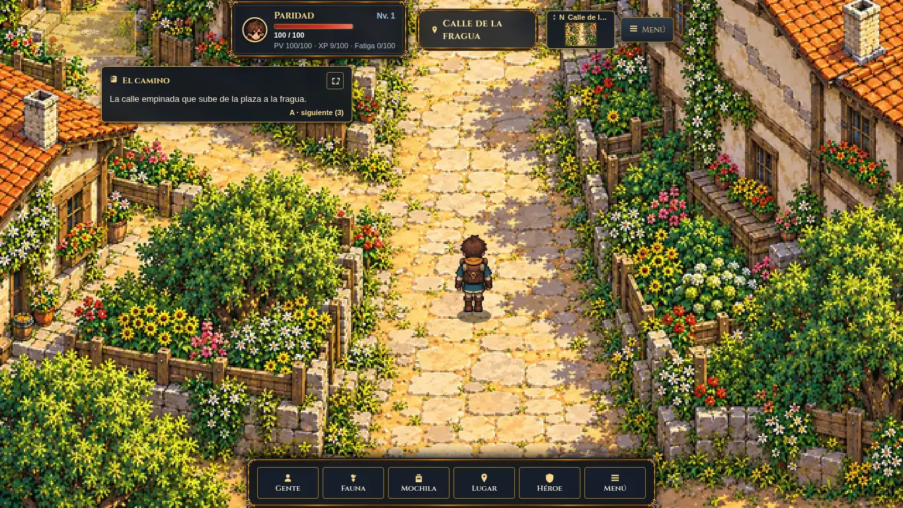
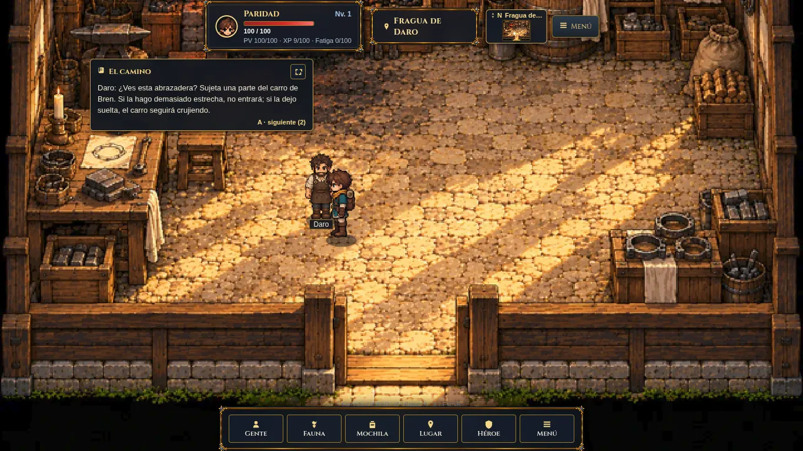

# Valdren02 — seis salas y cuatro personajes

El bloque amplía Valdren con calle de la fragua, casa de semillas, comedor, casa de cuidados, fragua y patio de ropa. Daro, Elva, Iria y Sena usan sprites propios y aparecen únicamente cuando los incluye el estado del servidor. No cambia motor, canon, acciones, recompensas ni balance.

Fecha:2026-10-18. Rama:`codex/rpg-valdren-02`, apilada sobre `05d1556` de PR743, que depende de PR742. Candidato validado localmente; integración y despliegue requieren aprobación. El candidato combinado tiene21salas pintadas de191; el validador cuenta212mapas porque comprueba191genéricos y21pintados.

## Arte y geometría

Seis WebP1280×960, todos≤250000bytes, con sus sidecars; cuatroPNG RGBA192×384,12frames64×96. Prompts/originales externos en `entregas/equipo/rpg-valdren-02/arte/`. Procedencia, pesos y hashes en [VAISGARD_RPG_ARTE.md](VAISGARD_RPG_ARTE.md). Daro/Elva conservan sus referenciasMUD; Iria/Sena interpretan roles sin retrato fijo. No se añaden datos canónicos.

| Sala | Salidas y elementos físicos |
|---|---|
| Calle | N/S centrales; O sigue ramal curvo hasta portal interior `[1,4,2,1]`. Seto y fachadas bloqueados. |
| Semillas | S `[8,14,4,1]`; mostrador y mesa/banco central bloqueados. Iria `[6,9]`. |
| Comedor | N `[9,0,2,1]`; mesa de tres tableros, bancos, hogar y taburete frontal bloqueados. Elva `[5,9]`. |
| Cuidados | E en umbral interior `[16,5,2,2]`; pared derecha, cama y mesa bloqueadas, muro sur cerrado. Sena `[9,8]`. |
| Fragua | S `[9,14,2,1]`; fuego, agua, banco posterior y taburetes bloqueados. Daro `[8,9]`. |
| Patio | E y O canónicos. O tiene dos zonas de activación hacia el mismo destino: borde `[0,7,1,2]` y puerta `[2,5,1,1]`. Poste `[15,6]` bloqueado. |

Los portales interiores representan puertas/caminos visibles sin exigir llegar a una pared exterior. Dos rectángulos de O en patio usan la misma acción y destino del servidor; no crean otra conexión. Las seis escenas conservan fuentesTiled y conversión bidireccional exacta.

La revisión detectó obstáculos omitidos y salidas desalineadas en la primera propuesta. El arquitecto corrigió estas huellas y las verificó de nuevo; las pruebas de alcance por sí solas no acreditaban coincidencia con el dibujo.

## Pruebas y límites

- Suite completa:315pruebas Python en134.330s, OK/1omitida. Después de los últimos ajustes de posición deNPC se reejecutaron las14pruebas focales de escenas, tiles y rutas:OK.
- `node scripts/check-rpg-client.mjs`:212mapas, todos los spawns/salidas alcanzables con volumen del avatar; presencia autoritativa, fallbackLina, precarga, dibujo y dimensiones reales de los cinco atlasNPC. Regresiones específicas impiden atravesar cama/mesas/taburete/seto o perder el ramal O y umbral de cuidados.
- `npm run check:client`, `node --check client-rpg/rpg.js`, `node --check scripts/qa-rpg-walk.js` y diferencias sin errores.
- QA final en390×844:15transiciones con destinos y celdas libres comprobados; aproximación a pie y diálogo ofrecido con los cuatroNPC. Las12capturas finales se repitieron en1366×768 y390×844. También se recorrió el segundo portal O del patio: mismo destinoCuidados y llegada libre.
- Ruta:Plaza→Calle→Fragua→Calle→Patio→Cuidados→Patio→Calle→Plaza→Huertos→Semillas→Huertos→Plaza→Pozo→Comedor→Pozo.
- En cada captura se verificó lienzo pintado, resolución igual al tamaño visible porDPR, y ausencia de solape de losNPC con HUD/relato. Daro, Elva e Iria se situaron en suelo libre donde permanezcan visibles.
- Chrome informó `document.hidden=true`. La sesión no entregaba consistentemente eventos de tamaño: se observó CSS390×844 con lienzo1366×768. QA invocó el manejador real `resizeCanvas` y `draw` antes de capturar; no se retocaron las imágenes ni se cambió el renderer para aparentar un resultado.
- Movimiento mediante teclas del cliente y pasos de `draw`, sin asignar coordenadas al avatar ni moverlo por fixture. Un evento táctil sintético activó el botón, movió al jugador hasta la colisión y lo liberó. La pulsación nativa enviada porCDP no activó la tecla en esta sesión oculta: no se certifican tacto físico ni fluidez sostenida de una pestaña activa.
- FixtureSQLite efímera. QA8771 cerrada mediante POST del transporte local y puerto libre comprobado; Chrome abierto con lienzo1366×768. Sin acceso a datos reales.

## Repetir el recorrido

`/home/jdiaz/proyectos/.venv-vt2/bin/python scripts/qa-rpg-valdren.py --port 8771` inicia el entorno desechable enPlaza. Abrirlo exclusivamente con `codex-browser`; entrar con el estado de fixture y cargar `scripts/qa-rpg-walk.js` mediante `codex-browser eval` leyendo el archivo como argumento estructurado.

`qaWalkExit(direccion, indicePortal=0)` utiliza teclas/dibujo y devuelve origen, destino, frames y celda libre. El llamador debe comprobar el destino canónico. `qaWalkExit('oeste',1)` permite probar la segunda puerta del patio. Al cambiar viewport, invocar `resizeCanvas` y `draw`; no confundir esta metodología con tacto físico.

Evidencia externa: `entregas/equipo/rpg-valdren-02/qa-browser-final.py`, `qa-final-results.json`, `qa-control-results.json`, `qa-secondary-portal.json` e informes de revisión. Originales en `rpg-preview/valdren02-final-*.png`. Cerrar el entorno mediante POST127.0.0.1:8771/__qa__/stop y comprobar puerto libre.

## Capturas del candidato

| Sala | Celular |
|---|---|
| Calle | [Ver](visual/rpg-valdren02-calle_alta-mobile.webp) |
| Fragua y Daro | [Ver](visual/rpg-valdren02-fragua-mobile.webp) |
| Patio | [Ver](visual/rpg-valdren02-patio_ropa-mobile.webp) |
| Cuidados y Sena | [Ver](visual/rpg-valdren02-cuidado-mobile.webp) |
| Semillas e Iria | [Ver](visual/rpg-valdren02-casa_semillas-mobile.webp) |
| Comedor y Elva | [Ver](visual/rpg-valdren02-comedor-mobile.webp) |

Este bloque no declara terminado el juego completo. Quedan aprobación, integración, despliegue y extensión visual al resto del mundo.
